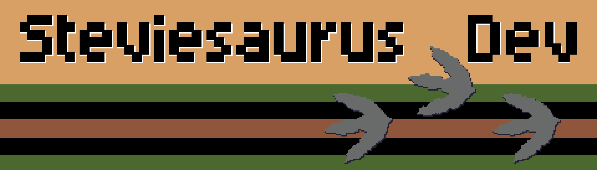

    

Hi, I'm Steve. By day I write code, and by night I'm the developer at **Steviesaurus Dev**, creating retro inspired games.
My main focus at this time is Commodore 64 BASIC games. I like working in the strict confines and pushing it to the limit.

- 💾 The Munching Millipede is close to complete, along with a web based demo
- 🔭 I'm working on UFO Intercept here and there, a space invaders inspired shooter
- 🚀 I recenlty imported my very first game, Battleship, and am rebranding it into the UFO Intercept story as Tactical Stand
- 🌱 I'm currently learning pixel art
- 🛠️ I’m currently working on my next C64 BASIC game, Methane Mayhem

[🐛 Play The Munching Millipede](https://steviesaurus-dev.itch.io/the-munching-millipede)

[🛸 Play UFO Intercept](https://steviesaurus-dev.itch.io/ufo-intercept)

[🚀 Play UFO Intercept: Tactical Stand](https://steviesaurus-dev.itch.io/tactical-stand)
